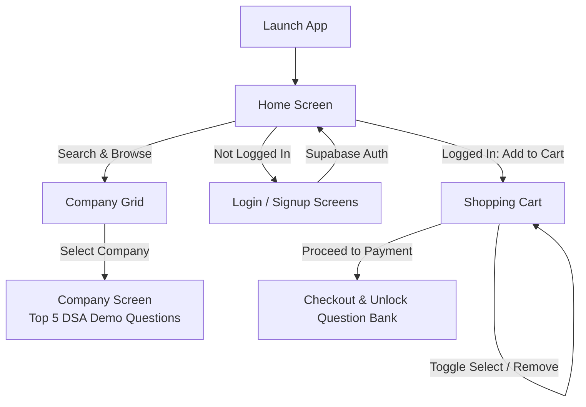

# 📱 OnlinePYQ — Tech Interview Question Bank App

[](https://expo.dev)
[](https://reactnative.dev)
[](https://supabase.com)
[](https://react.dev)
[](LICENSE)

**OnlinePYQ** is a cross-platform mobile application built with **React Native** and **Expo SDK 54**, powered by **Supabase Auth**. It is designed to assist software engineers, students, and job seekers in their technical interview preparation by offering curated, company-specific **Data Structures and Algorithms (DSA)** previous year questions (PYQs) from top tier tech giants.

---

## ✨ Features

- 🏢 **Company-Specific DSA Question Sets**
  - Curated interview questions categorized for industry leaders: **Google, Microsoft, Amazon, Netflix, Tesla, Tekion, Coinbase, and Oracle**.
  - Demo preview showing top 5 representative questions per company with indicators for premium question packs.

- 🔍 **Real-Time Search & Adaptive Layout**
  - Fast search filter on the home screen to quickly locate specific target companies.
  - Responsive multi-column grid layout that automatically adjusts between mobile and tablet screen widths.

- 🔐 **Supabase Authentication & Session Management**
  - Secure email & password signup with full name metadata.
  - Fast email & password login with active session tracking via `supabase.auth.onAuthStateChange`.
  - Conditional navigation and header state (Profile & Cart for authenticated users; Login & Signup for guests).

- 🛒 **Dynamic Cart & Checkout Flow**
  - Add company question packs directly to cart (priced at ₹3 each).
  - Interactive selection toggle with strikethrough visual cues and live total price calculation.
  - Item removal with confirmation prompt.
  - "Proceed to Payment" checkout integration point.

- 🧭 **Seamless Stack Navigation**
  - Fluid transitions using **React Navigation v6** Stack Navigator.
  - Persistent bottom footer with navigation links and dynamic copyright year.

---

## 🏗️ Architecture & User Flow



---

## 🛠️ Tech Stack

| Layer | Technology | Details |
|---|---|---|
| **Framework** | [React Native](https://reactnative.dev/) | `^0.81.5` with React 19 (`^19.1.0`) |
| **Tooling & Platform** | [Expo](https://expo.dev/) | SDK `~54.0.22` with New Architecture enabled |
| **Navigation** | [React Navigation](https://reactnavigation.org/) | `@react-navigation/native` & `@react-navigation/stack` v6 |
| **Backend & Auth** | [Supabase](https://supabase.com/) | `@supabase/supabase-js` (Auth & User Sessions) |
| **Storage & Polyfills** | Async Storage & Polyfills | `@react-native-async-storage/async-storage`, `react-native-url-polyfill`, `react-native-get-random-values` |
| **HTTP Client** | [Axios](https://axios-http.com/) | `^1.6.8` for external API integration |

---

## 📂 Project Structure

```text
rn_project_qb/
├── assets/                     # App icons, splash screens, and adaptive assets
│   ├── adaptive-icon.png
│   ├── favicon.png
│   ├── icon.png
│   └── splash-icon.png
├── screens/                    # Application screens and UI components
│   ├── HomeScreen.js           # Company catalog, search, auth header, cart trigger
│   ├── CompanyScreen.js        # Company-specific DSA questions & demo previews
│   ├── CartScreen.js           # Cart management, item selection toggle & checkout
│   ├── LoginScreen.js          # Supabase email/password login screen
│   ├── SignupScreen.js         # Supabase registration screen with user metadata
│   └── Footer.js               # Persistent footer component with external links
├── App.js                      # Root navigation container and stack configuration
├── index.js                    # Entry point & Expo root component registration
├── supabase.js                 # Supabase client initialization & polyfill setup
├── app.json                    # Expo configuration (icons, orientation, new architecture)
└── package.json                # Project dependencies and run scripts
```

---

## 🚀 Getting Started

### Prerequisites

Ensure you have the following installed on your development machine:
- [Node.js](https://nodejs.org/) (v18.x or v20.x recommended)
- [npm](https://www.npmjs.com/) or [yarn](https://yarnpkg.com/)
- [Expo Go](https://expo.dev/go) app installed on your physical iOS or Android device (or an active iOS Simulator / Android Emulator).

### 1. Clone the Repository

```bash
git clone https://github.com/Jeet267/rn_project_qb.git
cd rn_project_qb
```

### 2. Install Dependencies

```bash
npm install
```

### 3. Configure Supabase

The application uses Supabase for user authentication. The client is configured in `supabase.js`:

```javascript
import 'react-native-url-polyfill/auto';
import 'react-native-get-random-values';
import { createClient } from '@supabase/supabase-js';

const SUPABASE_URL = 'YOUR_SUPABASE_PROJECT_URL';
const SUPABASE_ANON_KEY = 'YOUR_SUPABASE_ANON_KEY';

export const supabase = createClient(SUPABASE_URL, SUPABASE_ANON_KEY);
```

> [!NOTE]
> Make sure **Email Provider** is enabled under **Authentication > Providers** in your Supabase dashboard.

### 4. Run the Development Server

Start the Expo Metro bundler:

```bash
npm start
```

Or run directly targeting a specific platform:

```bash
# Run on Android Emulator / Device
npm run android

# Run on iOS Simulator (macOS only)
npm run ios

# Run in Web Browser
npm run web
```

Scan the displayed QR code with the **Expo Go** app (Android) or the **Camera app** (iOS) to test the app live on your device.

---

## 📱 Screens & Features Walkthrough

### 1. `HomeScreen.js`
- Displays a welcoming hero banner and tech company question catalog.
- Includes a live search bar that dynamically filters company cards.
- Provides dynamic authentication actions:
  - **Guests**: Quick links to **Login** and **Signup**.
  - **Logged-in Users**: Shows active **Cart count**, **Profile** modal, and **Logout** button.
- Allows authenticated users to add specific company question packs to their cart.

### 2. `CompanyScreen.js`
- Displays curated previous year interview DSA questions tailored to the selected company.
- Highlights foundational and advanced problems (e.g., Graph cycle detection, LRU Cache, Tree traversals, Kadane's algorithm, Dijkstra's algorithm).
- Displays preview banners notifying users that additional questions and updates unlock upon package purchase.

### 3. `CartScreen.js`
- Shows all added company packs with individual prices (₹3 default).
- Supports interactive checkboxes/toggles to include or exclude items from checkout (with line-through styling).
- Live calculation of total order price.
- Swipe or tap to remove items with confirmation dialog.
- "Proceed to Payment" action button.

### 4. `LoginScreen.js` & `SignupScreen.js`
- Clean, validated input forms for authentication.
- Seamless connection to Supabase Auth (`signInWithPassword` & `signUp`).
- Stores user metadata (e.g., `full_name`) upon registration.

### 5. `Footer.js`
- Displayed persistently across screens.
- Contains links to About, Contact, and Privacy Policy, along with dynamic current-year copyright branding.

---

## 📜 Available NPM Scripts

| Script | Command | Purpose |
|---|---|---|
| `start` | `expo start` | Starts the Metro bundler with interactive CLI menu |
| `android` | `expo start --android` | Boots Metro and opens the app on a connected Android device or emulator |
| `ios` | `expo start --ios` | Boots Metro and launches the iOS Simulator |
| `web` | `expo start --web` | Starts a local web server for browser preview |

---

## 🔮 Roadmap

- [ ] **Payment Gateway Integration**: Integrate Razorpay / Stripe for seamless payment processing.
- [ ] **Dynamic Supabase Database**: Migrate hardcoded company questions to a Supabase Postgres table with real-time updates.
- [ ] **PDF & Offline Export**: Allow users to download solved PYQ papers as PDFs for offline study.
- [ ] **Dark Mode Support**: Add system-aware dark theme toggle for comfortable night-time revision.
- [ ] **Code Editor / Compiler Playground**: In-app code editor to practice questions directly within the app.

---

## 🤝 Contributing

Contributions are always welcome!
1. Fork the Project.
2. Create your Feature Branch (`git checkout -b feature/AmazingFeature`).
3. Commit your Changes (`git commit -m 'Add some AmazingFeature'`).
4. Push to the Branch (`git push origin feature/AmazingFeature`).
5. Open a Pull Request.

---

## 📄 License

This project is open-source and available under the [MIT License](LICENSE).
